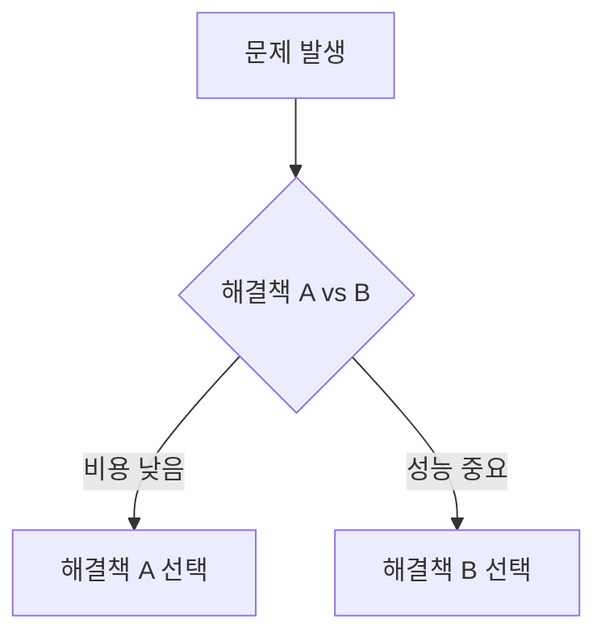
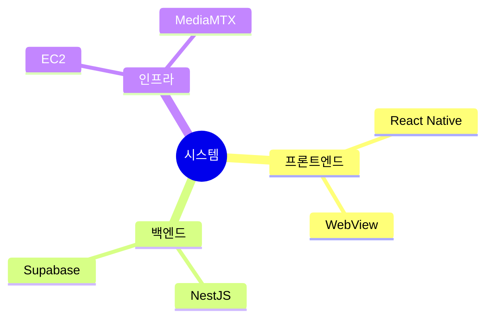
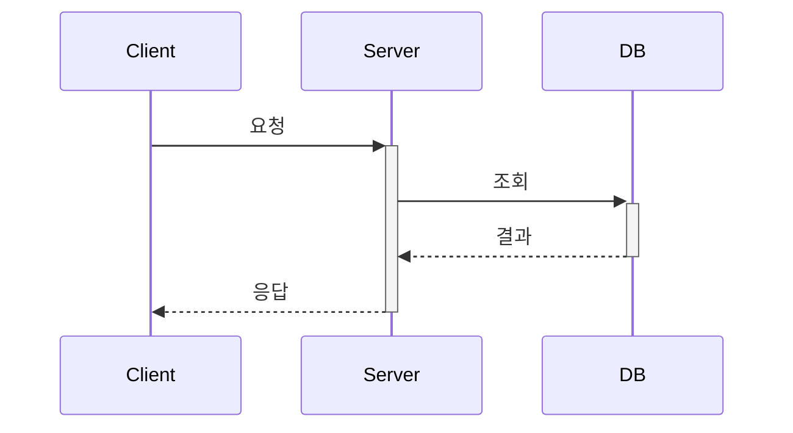

# Notion 시각화 가이드

복잡한 개념을 직관적으로 전달하기 위해 시각화 도구를 최대한 활용하세요.

## 핵심 원칙

> **글로 설명하기 전에, 도식화할 수 있는지 먼저 고민하라**

- 복잡한 관계 → 다이어그램으로
- 비교/대조 → 표 또는 컬럼으로
- 계층 구조 → 마인드맵으로
- 시간 순서 → 타임라인으로

---

## 1. Mermaid 다이어그램 (복잡한 개념 도식화)

### 다이어그램 유형별 활용

| 다이어그램          | 용도                      | 예시 상황                        |
| ------------------- | ------------------------- | -------------------------------- |
| **flowchart**       | 프로세스, 의사결정 흐름   | 배포 파이프라인, 에러 처리 로직  |
| **sequenceDiagram** | 시스템 간 상호작용        | API 호출 흐름, 인증 과정         |
| **stateDiagram-v2** | 상태 전이                 | 주문 상태, 연결 상태             |
| **mindmap**         | 개념 계층화, 브레인스토밍 | 기술 스택 정리, 요구사항 분류    |
| **timeline**        | 시간 순서, 이벤트 흐름    | 프로젝트 히스토리, 장애 타임라인 |
| **erDiagram**       | 데이터 관계               | DB 스키마, 엔티티 관계           |
| **classDiagram**    | 클래스/모듈 관계          | 아키텍처 설계, 의존성            |
| **gitGraph**        | 브랜치 전략               | Git 워크플로우 설명              |
| **pie**             | 비율, 분포                | 리소스 할당, 시간 배분           |
| **quadrantChart**   | 2x2 매트릭스 분석         | 우선순위 결정, 기술 선택         |
| **journey**         | 사용자 경험 흐름          | UX 플로우, 온보딩 과정           |

### 복잡한 개념 도식화 예시

**의사결정 과정 (flowchart)**



**개념 계층화 (mindmap)**



**시스템 상호작용 (sequenceDiagram)**



---

## 2. Notion 네이티브 기능

### Callout (정보 유형별 구분)

- 🎯 **결론/핵심** → `color="green"`
- ⚠️ **주의/경고** → `color="yellow"` 또는 `color="red"`
- 💡 **팁/인사이트** → `color="blue"`
- 📋 **요약/정리** → `color="gray"`

### Columns (비교 배치)

- 2개 옵션 비교 시 나란히 배치
- Before/After 표현

### Table (구조화된 비교)

- `header-row="true"` 필수
- 색상으로 상태 구분 (green=권장, red=비권장)

### Toggle (상세 정보 숨김)

- 길어지는 설명은 토글로 접기
- 선택적으로 볼 내용 분리

---

## 3. ASCII 다이어그램 (코드 블록 내 도식)

아키텍처, 데이터 흐름 등 간단한 구조:

```
[Client] --> [Nginx] --> [Server]
                |
                v
            [MediaMTX] --> [HLS]
```

---

## 4. 상황별 시각화 조합 가이드

### 의사결정 문서 (ADR, 기술 선택)

| 상황                    | 권장 조합                                                                   |
| ----------------------- | --------------------------------------------------------------------------- |
| 여러 옵션 비교 후 선택  | flowchart (결정 흐름) → Table (옵션 비교) → Callout (최종 선택 이유)        |
| 문제 → 해결책 도출 과정 | Callout (문제 정의) → mindmap (해결책 브레인스토밍) → flowchart (선택 과정) |
| 기술 A vs B 심층 비교   | Columns (나란히 배치) + Table (세부 항목) + quadrantChart (트레이드오프)    |
| 과거 결정의 히스토리    | timeline (결정 시점들) + Callout (각 결정의 배경)                           |

### 시스템/아키텍처 문서

| 상황                  | 권장 조합                                            |
| --------------------- | ---------------------------------------------------- |
| 전체 시스템 구조 개요 | mindmap (계층 구조) + ASCII (데이터 흐름)            |
| 컴포넌트 간 통신      | sequenceDiagram (호출 순서) + Callout (주의점)       |
| 마이크로서비스 관계   | flowchart (서비스 간 연결) + erDiagram (데이터 관계) |
| 상태 기반 시스템      | stateDiagram-v2 (상태 전이) + Table (각 상태 설명)   |
| 배포/인프라 구조      | ASCII (인프라 다이어그램) + Table (각 컴포넌트 역할) |

### 프로세스/워크플로우 문서

| 상황                      | 권장 조합                                                 |
| ------------------------- | --------------------------------------------------------- |
| 단순 순차 프로세스        | flowchart (TD 방향)                                       |
| 분기가 많은 프로세스      | flowchart + Callout (각 분기 조건 설명)                   |
| 여러 주체가 참여          | sequenceDiagram (주체별 역할) + swimlane 스타일 flowchart |
| 반복/루프가 있는 프로세스 | stateDiagram-v2 (상태 순환)                               |
| 에러 처리 포함            | flowchart (정상 흐름) + Callout (red, 에러 케이스)        |

### 데이터/모델 문서

| 상황           | 권장 조합                                        |
| -------------- | ------------------------------------------------ |
| DB 스키마 설명 | erDiagram (관계) + Table (각 필드 설명)          |
| 데이터 흐름    | flowchart (변환 과정) + ASCII (입출력 형태)      |
| API 스펙       | Table (엔드포인트) + sequenceDiagram (호출 예시) |

### 분석/의사결정 문서

| 상황             | 권장 조합                                         |
| ---------------- | ------------------------------------------------- |
| 우선순위 결정    | quadrantChart (중요도/긴급도) + Table (상세 기준) |
| 리소스/시간 배분 | pie (비율) + Table (항목별 설명)                  |
| 장단점 분석      | Columns (장점/단점) + Callout (결론)              |
| SWOT 분석        | quadrantChart 또는 2x2 Table                      |

### 온보딩/가이드 문서

| 상황               | 권장 조합                                     |
| ------------------ | --------------------------------------------- |
| 단계별 설정 가이드 | flowchart (전체 흐름) + Toggle (각 단계 상세) |
| 트러블슈팅         | flowchart (진단 흐름) + Callout (해결책)      |
| 개념 설명          | mindmap (개념 구조) + Callout (핵심 정의)     |
| 사용자 여정        | journey (UX 흐름) + Callout (각 단계 팁)      |

### 히스토리/변경 문서

| 상황              | 권장 조합                                               |
| ----------------- | ------------------------------------------------------- |
| 프로젝트 타임라인 | timeline + Callout (주요 이벤트)                        |
| 버전 변경 이력    | Table (버전별) + Toggle (상세 변경 내용)                |
| Git 전략 설명     | gitGraph + Callout (브랜치 규칙)                        |
| 장애 리포트       | timeline (발생→대응→해결) + sequenceDiagram (원인 분석) |

---

## 5. 조합 원칙

1. **개요 → 상세**: 큰 그림(mindmap, flowchart) 먼저, 상세(Table, Callout) 나중
2. **흐름 + 강조**: 다이어그램으로 흐름 보여주고, Callout으로 핵심 강조
3. **비교는 나란히**: Columns 또는 Table로 시각적 대비
4. **복잡하면 분리**: Toggle로 상세 내용 숨기기
5. **색상은 의미있게**: green=긍정/선택, red=주의/거부, yellow=경고, blue=정보
